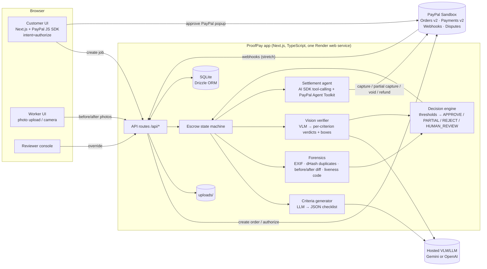

# ProofPay — vision‑verified escrow payments on PayPal

> **Money moves when the camera says the job is done.**
> Built for the [PayPal AI Hackathon](https://paypalaihackathon.devpost.com/) (submissions close **Thu 12 Nov 2026, 12:00 PST = 21:00 CET**).

ProofPay holds a customer's payment with a **PayPal authorization** (Orders v2, `intent: AUTHORIZE`), asks the worker for **before/after photo evidence**, and lets a **vision‑language model** check that evidence against a checklist an LLM generated from the job description. Pass → PayPal **capture**. Partially done → an **AI settlement agent** proposes a **partial capture** with a plain‑English explanation. Fail, suspected fraud or low confidence → funds stay on hold and a **human reviewer** gets an evidence report (which can be reused as dispute evidence).

---

## The problem (one paragraph)

Paying for real‑world work is still trust‑by‑default. Marketplaces either pay the worker the moment the customer clicks "pay" (customer carries the risk) or after a vague "mark as done" button (worker's word against the customer's). Parcels get marked "delivered" with no photo; cleaners, handymen and couriers get paid — or don't — based on whoever complains loudest, and the dispute is settled weeks later from screenshots. Card holds and escrow exist, but **nobody checks the actual evidence before the money moves**. ProofPay makes the evidence the trigger: an authorization hold for up to 29 days, a computer‑vision check of before/after proof against explicit acceptance criteria, fraud checks on the photos themselves, and a capture, partial capture or void that follows from that check — with an audit trail both sides can see.

## Demo story (origin)

On Fri 7 Nov 2026 a parcel tracker said Adarsh's new fitness tracker was *"delivered"* in Enschede. It never arrived. There was no delivery photo, just a status line, so it turned into days of support calls. **With ProofPay the courier's payout would have been held until a photo of the parcel at the right door, with that day's one‑time code visible, passed verification.**

The 3‑minute demo (see [`docs/DEMO_AND_SUBMISSION.md`](docs/DEMO_AND_SUBMISSION.md)) shows three jobs:
1. **Bike chain replacement**: verified, **full capture** in the PayPal sandbox.
2. **Apartment cleaning, 4 of 5 criteria met**: the agent proposes a **partial capture** (e.g. 80%) and the customer accepts in one click.
3. **"Delivered" parcel with a reused photo**: the duplicate‑image check fires, funds stay **on hold**, the job goes to **human review**, an evidence pack is generated, and the authorization is **voided**.

## Architecture



## Quickstart (judges)

Requirements: Node.js 20+ (`node -v`), npm 10+, git, a free [PayPal Developer](https://developer.paypal.com/) account (sandbox). Optional: a Gemini or OpenAI API key.

```bash
git clone https://github.com/adarsh-nl/proofpay.git && cd proofpay
npm ci
cp .env.example .env.local
#  Edit .env.local:
#    PAYPAL_CLIENT_ID=<sandbox client id>       (Developer Dashboard → Apps & Credentials → Sandbox → Create App)
#    PAYPAL_CLIENT_SECRET=<sandbox secret>
#    NEXT_PUBLIC_PAYPAL_CLIENT_ID=<same as PAYPAL_CLIENT_ID>
#    VISION_MOCK=1                              (no AI key needed; uses recorded AI responses in eval/fixtures)
#    or: VISION_MOCK=0 + AI_PROVIDER=google + GOOGLE_GENERATIVE_AI_API_KEY=<key>
npm run db:reset                  # creates ./data/proofpay.db, seeds 3 demo jobs
npm run dev                       # → http://localhost:3000
```

Try it (about 3 minutes):
1. Open `http://localhost:3000/?as=customer` → **New job** → e.g. "Replace bike chain", category *bike_repair*, $60 → **Create**. Review the AI checklist → **Save**.
2. Click the **PayPal** button → log in with your **sandbox personal (buyer) account** (Developer Dashboard → Testing Tools → Sandbox Accounts → the default `…@personal.example.com`; view its password there) → approve. You'll see **"Funds held by PayPal"**.
3. Open `/?as=worker` → the job → note the 4‑digit code → upload `eval/pairs/06-*/before_1.jpg` and `after_1.jpg` → **Submit**.
4. Back on `/?as=customer` → the job shows per‑criterion verdicts with boxes → **Captured** in the money timeline. Check the sandbox business account's activity to see the capture.
5. Optional: repeat with `eval/pairs/04-*` (partial → accept the agent's proposal) and `eval/pairs/16-*` (duplicate photo → human review → `/?as=reviewer` → reject → hold voided).

Hosted demo: `https://<render-url>` *(added by task T15)*. **Sandbox only. No real money moves.**

Other commands: `npm run check` (lint + typecheck + unit tests) · `npm run e2e` (Playwright) · `npm run eval` (vision eval → `eval/report.md`).

Limitations (honest): role switching via `?as=` is a demo convenience, not authentication. On Render's free tier the SQLite DB and uploads reset on restart. The AI can be wrong, so low‑confidence or suspicious cases always go to a human.

---

## For the team (Adarsh, Collaborator, and their AI agents)

### Where things live
| What | Where |
|---|---|
| Repo | https://github.com/adarsh-nl/proofpay |
| **Task board (source of truth for status)** | Notion → **ProofPay Tasks**: https://app.notion.com/p/e1809761315044039838e9ff7bc70f02 |
| Project page (links, timeline, how to use the board) | https://app.notion.com/p/4145007c7d318100acf3ee62d7b1b521 |
| Rules for agents (ownership, commands, DoD) | [`AGENTS.md`](AGENTS.md) |
| Spec | [`docs/MANUAL.md`](docs/MANUAL.md) |
| Prompts per task | [`docs/AGENT_PROMPTS.md`](docs/AGENT_PROMPTS.md) |
| Secrets | Password manager / Signal **only** (never git, Notion, PRs or agent chats) |

### Deadlines (CET)
- **Wed 18:00**: MVP freeze (every MVP task merged)
- **Thu 15:00**: code freeze (docs only after)
- **Thu 18:00**: Devpost submitted (our target)
- **Thu 21:00**: hard deadline (= 12:00 PST)
- Adarsh is offline **Thu ~08:00–12:00** (US visa interview at 09:15)

### First 30 minutes for the Collaborator (step by step)
1. Accept the GitHub invite to `adarsh-nl/proofpay` and the Notion page share.
2. Install: Node 20+ (`node -v`), git, **Cursor**, **Google Antigravity**, Google Chrome. Optional: Claude Code (`npm i -g @anthropic-ai/claude-code`; verify the install command in Anthropic's docs) for T12, T15 and S02.
3. `git clone https://github.com/adarsh-nl/proofpay.git && cd proofpay && npm ci` (after T00 has merged).
4. Get the sandbox `PAYPAL_CLIENT_ID` / `PAYPAL_CLIENT_SECRET` from Adarsh via password manager → `cp .env.example .env.local` → paste them in → keep `VISION_MOCK=1`.
5. `npm run db:reset && npm run dev`, then open http://localhost:3000.
6. Read `AGENTS.md` §0–§4 and §9–§10 (15 min), then `docs/MANUAL.md` §1–§4 and §8.
7. Open Notion → ProofPay Tasks → filter `Owner = Collaborator` → start **F01** (set it to *In progress*).
8. Open Cursor on the repo → Agent mode → paste the **F01** block from `docs/AGENT_PROMPTS.md`.

### How to do any task (humans)
```bash
git switch main && git pull --ff-only
git switch -c feat/<TaskID>-<slug>              # exact name is in the Notion row's "Branch"
# Notion: Status → In progress
# paste the prompt for <TaskID> from docs/AGENT_PROMPTS.md into the tool named in the row
npm run check                                   # must be green
git push -u origin feat/<TaskID>-<slug>
gh pr create --fill --title "[<TaskID>] <title>"   # or open the PR on GitHub
# Notion: Status → In review, paste PR URL in "Prompt link / notes"
# other human reviews → squash merge → Notion: Status → Done
```
Parallel agents on one laptop: use a worktree per task (`git worktree add ../proofpay-<TaskID> -b <branch> origin/main`) so two agents never share a working copy.

### Who works where (summary of AGENTS.md §4)
| Tool | Writes to | Never touches |
|---|---|---|
| Claude Code | `src/server/**`, `src/app/api/**`, `src/shared/**`*, `tests/unit/**`, `scripts/**` (not eval), `drizzle/**`, `render.yaml`, `.github/**` | UI, e2e, eval |
| Cursor | `src/app/**` (not api), `src/components/**`, `src/lib/**`, `src/styles/**`, `public/**` | server, shared, api, tests, eval |
| Antigravity | `tests/e2e/**`, `eval/**`, `scripts/eval*.ts`, `playwright.config.ts`, `docs/img/**` | src/** |

\* `src/shared/**` is frozen after T01. Changes need the `contract-change` label and approval from both humans.

### Definition of Done (short)
Acceptance criteria met and quoted in the PR · `npm run check` green locally + CI · tests/screenshots attached · no secrets · only owned paths touched · docs/env updated · reviewed and merged · Notion = Done. Full list: `AGENTS.md` §10.

## Documentation index

| File | What it's for |
|---|---|
| [`docs/MANUAL.md`](docs/MANUAL.md) | Master build manual: goals, scope tiers, stack, data model, state machine, API contract, vision pipeline, PayPal integration, security, agentic layer |
| [`docs/TASKS.md`](docs/TASKS.md) | Task board: IDs, owner, tool, dependencies, estimates, acceptance criteria, timeline, file ownership |
| [`docs/AGENT_PROMPTS.md`](docs/AGENT_PROMPTS.md) | Copy‑paste starter prompts per task for Cursor, Claude Code and Antigravity |
| [`docs/COLLABORATION.md`](docs/COLLABORATION.md) | Git workflow for 2 humans + 3 agents, PR rules, sync checkpoints |
| [`docs/DEMO_AND_SUBMISSION.md`](docs/DEMO_AND_SUBMISSION.md) | 3‑minute video script, Devpost checklist, talking points, risks & fallbacks |
| [`docs/DIRECTORY_TREE.md`](docs/DIRECTORY_TREE.md) | Proposed repository layout with owners |
| [`docs/REFERENCES.md`](docs/REFERENCES.md) | Every external fact we rely on, with the source link and what still needs verifying |
| [`AGENTS.md`](AGENTS.md) | Rules for AI coding agents (read by Cursor, Claude Code via `CLAUDE.md`, and Antigravity) |

## Built with

PayPal Orders API v2 · PayPal Payments API v2 (authorize / capture / void / reauthorize / refund) · PayPal JS SDK · PayPal Agent Toolkit · (stretch) PayPal Webhooks, Disputes API, Payouts API · Vercel AI SDK · Gemini / OpenAI vision models · Next.js · TypeScript · SQLite + Drizzle · sharp · exifr · Render.

## License

MIT (see `LICENSE`). Devpost requires a public repo with an open‑source licence visible in GitHub's About section.
